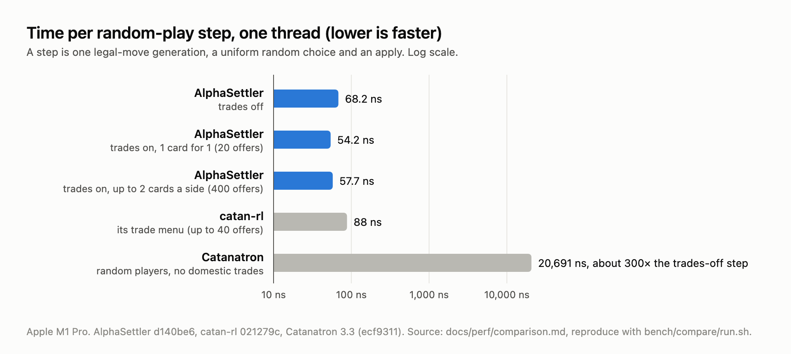

# AlphaSettler

A four-player Settlers of Catan bot: a Rust rules engine, information-set Monte Carlo tree search
over hidden hands, and a graph network trained by self-play, with Python bindings for the arena
and training.

## Headline evidence

| Result | Source |
|---|---|
| About **300× faster per step than Catanatron** in random play: 68.2 ns against 20,691 ns, one thread, domestic trades off | [`docs/perf/comparison.md`](docs/perf/comparison.md), [wiki: Performance testing](https://seanpatrickmay.me/wiki/alphasettler/wiki/performance-testing/) |
| About **700,000 search simulations a second** on one core with the heuristic evaluator, 1.4 ms for a 1,000-simulation decision | [`docs/perf/search.md`](docs/perf/search.md) |
| The network bot won **0.585 of 800 games against three of Catanatron's AlphaBeta bots** (0.25 is an even share; 95% CI 0.548 to 0.622) | [`docs/bot/results-3b.md`](docs/bot/results-3b.md) |
| The rules were checked against Catanatron step by step: **50,000 games, 53.3M steps, 0 unexplained mismatches** | [`docs/oracle/results.md`](docs/oracle/results.md) |

All numbers are from an Apple M1 Pro. The 700k figure is the heuristic search. With the learned
network as the evaluator, the search runs about 28,000 simulations a second on one core, because
each leaf needs a forward pass ([`docs/perf/net-search.md`](docs/perf/net-search.md)).



## Why it is hard

Catan hides information. A player cannot see the cards in opponents' hands, their development
cards or the order of the deck, and dice decide what everyone collects. Four players move, so
there is no single opponent to minimise against. A bot has to reason about what it does not
know.

## How it works

```
engine/    rules, legal moves, per-seat observations, event log
   |
search/    belief over hidden hands, sampled worlds, PUCT tree search
   |
net/       position encoder, graph network forward pass, NetEvaluator
   |
bots/      random, greedy, IsmctsBot, NetBot, opening model, arena, self-play
   |
bindings/  PyO3 module alphasettler._engine
   |
alphasettler/  CLI, arena, SPRT, self-play records, PyTorch training     oracle/  Catanatron adapter
```

- **Engine** (`engine/`, crate `settler-engine`). The full rules, with every legal move encoded as
  an integer from 0 to 664 (`engine/src/action.rs`). Cloning a state takes about 12 ns
  ([`docs/perf/engine-baseline.md`](docs/perf/engine-baseline.md)). A golden trace of 600 seeded
  games and property tests guard every change (`engine/tests/`).
- **Belief** (`search/src/belief.rs`). Every resource movement is public except a steal the viewer
  did not see, so the bot keeps the exact posterior over all four hands (capped at 65,536
  states).
- **Search** (`search/src/search.rs`, `puct.rs`, `world.rs`). Each simulation samples a complete
  world consistent with what the bot has seen, then walks one shared tree with PUCT selection. Each
  player maximises their own value, and leaves are evaluated in batches of 8. `gumbel.rs` (a
  sequential-halving root) and `compound.rs` (bank trades bundled with the build they enable) are
  experiments behind bot-name suffixes.
- **Network** (`net/`). A graph network over the board's tiles, nodes and edges: width 48, 2
  rounds, about 247,000 parameters. It gives a policy over the 665 moves and a win probability for
  each seat. The forward pass is written in Rust and uses Apple's Accelerate on macOS
  (`net/src/forward.rs`).
- **Self-play** (`alphasettler/train/`, `bots/src/selfplay.rs`). Rust plays the games and writes
  records. PyTorch trains the next net, and a gate match against the current best decides
  whether it is promoted.
- **Arena** (`bots/src/arena.rs`, `alphasettler/arena.py`). One candidate plays three copies of a
  baseline. Each seed is four games, with the candidate in every seat, so results are not decided
  by seat order. Results come with a 95% CI and a z-score against 0.25, or a sequential test
  (`alphasettler sprt`).
- **Oracle** (`oracle/`). Translates boards, moves and events to and from Catanatron 3.3, so our
  bots can play inside Catanatron and the two engines can be compared step by step.

## Quickstart

Needs Rust (built with rustc 1.98.1) and Python 3.12 or later.

```sh
# Rust: tests and two benchmarks
cargo test --workspace --release
cargo run --release -p settler-engine --example throughput 10000
cargo run --release -p settler-bots --example search_speed 2000 1000

# Python bindings and the CLI
python3 -m venv .venv
.venv/bin/pip3 install maturin==1.15.0 pytest==9.1.1
VIRTUAL_ENV=$PWD/.venv .venv/bin/maturin develop --release
.venv/bin/alphasettler arena --candidate ismcts@100 --baseline greedy --seeds 200 --no-trades
.venv/bin/python3 -m pytest -q   # the full suite needs the train extra, below
```

The arena line plays 800 games in a few seconds and should print a win rate of 0.330, the same
as [`docs/bot/results-3a.md`](docs/bot/results-3a.md). Games are seeded, so results repeat
exactly.

Optional extras, listed in `pyproject.toml`:

- **train** (`torch==2.14.1`): needed for `train`, `fast-train`, `train-loop` and their tests.
  Without it those tests fail at import.
- **oracle** (Catanatron, pinned to a commit): needed for `oracle-diff` and the `catanatron:`
  baselines, for example `--baseline catanatron:alphabeta`. Without it the oracle tests are
  skipped.
- `bench/compare/run.sh 20000` clones catan-rl and Catanatron into a gitignored cache and reruns
  the speed comparison (macOS).

`alphasettler --help` lists the rest: `selfplay`, `compare`, `opening-train`, `net-upgrade` and
others.

## Repo layout

| Path | What it holds |
|---|---|
| `engine/` | Rust rules engine, benches and examples (`settler-engine`) |
| `search/` | Belief, sampled worlds and the tree search (`settler-search`) |
| `net/` | Encoder, graph network, weights file and evaluator (`settler-net`) |
| `bots/` | Bots, the native arena and self-play (`settler-bots`) |
| `bindings/` | PyO3 extension module `alphasettler._engine` |
| `alphasettler/` | Python CLI, arena, statistics and training |
| `oracle/` | Catanatron adapter, differential test and a web UI server for playing the bots by hand |
| `tests/python/` | Python tests |
| `bench/compare/` | Speed comparison against catan-rl and Catanatron |
| `runs/` | Scripts behind each measurement; their outputs and trained nets are gitignored |
| `docs/` | Results (`bot/`, `perf/`, `oracle/`) and the spec and plan for each sub-project (`superpowers/`) |

## Status and limitations

- **No evidence against strong human players.** The bots have been measured only against other
  bots: Catanatron's value-function and AlphaBeta bots, scripted styles, and their own earlier
  nets. The author has beaten them by hand, and those games set the agenda for sub-project 3d
  (`docs/superpowers/specs/2026-10-08-opening-model-design.md`).
- **Trained nets are not in the repo.** `runs/` outputs are gitignored, so `net:` bots need a
  weights file you train yourself. `ismcts`, `greedy` and `random` work from a fresh clone.
- **Recent experiments found no gain.** Gumbel self-play, the opening model in self-play, the v4
  encoder, a league of past nets and compound moves each failed their sequential test against the
  control. The results are kept in `docs/bot/`. Two of them do help at play time: the opening
  model ([`docs/bot/results-3d1.md`](docs/bot/results-3d1.md)) and the Gumbel root at 32 and 100
  simulations ([`docs/bot/results-p2-gumbel.md`](docs/bot/results-p2-gumbel.md)).
- **JSettlers2 is not built yet.** An arena against its trading robots exists only as a spec and a
  plan (`docs/superpowers/specs/2026-10-09-jsettlers2-arena-design.md`).
- **One machine.** Every benchmark ran on an Apple M1 Pro. The fast forward pass uses Accelerate.
  Other platforms fall back to a plain Rust matrix product, which is slower and not benchmarked.
- **Rule differences.** Catanatron and catan-rl differ from these rules in trade menus and when a
  player can win, so the speed comparison is per step and the differential test uses an allowlist
  (`oracle/allowlist.py`).

## Links

- Wiki: https://seanpatrickmay.me/wiki/alphasettler/ (generated by RepoWiki at commit `dac6e2f`,
  including the [network training](https://seanpatrickmay.me/wiki/alphasettler/wiki/network-training/)
  and [network evaluation](https://seanpatrickmay.me/wiki/alphasettler/wiki/network-evaluation/) pages)
- Project deep dive: https://seanpatrickmay.me/projects/alphasettler/
